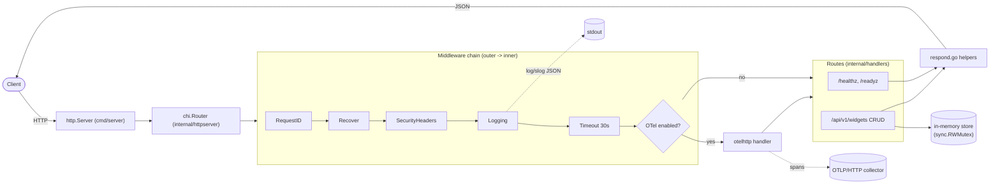
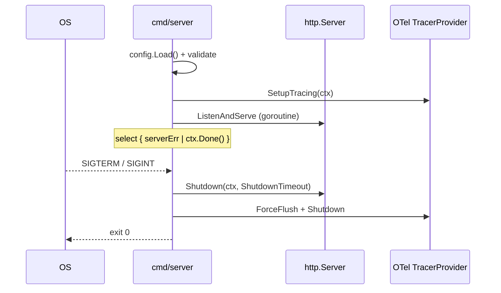
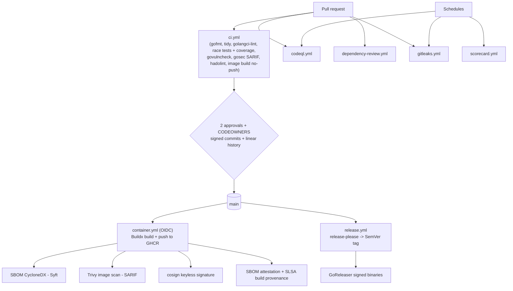

# Architecture

`template-backend-go` is a single, self-contained HTTP service that follows a strict
transport / logic separation and the 12-factor methodology. This document describes the
runtime request path, the package boundaries, and the supply-chain pipeline.

## Runtime request flow

### Component responsibilities

| Package | Responsibility |
| --- | --- |
| `cmd/server` | Wire-up: load config, build the slog JSON logger, set up OpenTelemetry, construct the `http.Server` with timeouts, run it, and drain on `SIGINT`/`SIGTERM`. Also implements `-healthcheck` (used by the Docker `HEALTHCHECK`) and `-version`. |
| `internal/config` | Parse + validate environment configuration (`caarlos0/env` + `go-playground/validator`). Safe defaults so the service boots with no env set. |
| `internal/httpserver` | Build the chi router and the middleware chain. Transport-only — no business logic. |
| `internal/handlers` | Health probes and the v1 widgets CRUD API (in-memory store) plus the canonical JSON response helpers. |
| `internal/observability` | Configure the OpenTelemetry tracer (OTLP/HTTP exporter; W3C propagation always installed; no-op when disabled). |

### Lifecycle

The readiness probe (`/readyz`) returns `503` while draining so an orchestrator stops routing
traffic before connections are closed.

## Configuration

Configuration is entirely environment-driven (see `internal/config/config.go` and
`.env.example`). Networking, service identity, log level, HTTP timeouts, request size caps and
OpenTelemetry settings are all tunable; every key has a safe default.

## Container

A multi-stage `Dockerfile` builds a fully static binary (`CGO_ENABLED=0`, `-trimpath`,
stripped, version-stamped via `-ldflags`) in `golang:1.27-bookworm`, then copies it into
`gcr.io/distroless/static-debian12:nonroot`. The final image has no shell or package manager,
runs as uid `65532`, exposes `8080`, and uses the binary's own `-healthcheck` mode for the
`HEALTHCHECK`. Pin the base images by digest in real deployments.

## Supply-chain pipeline

Every workflow pins its actions to full 40-hex commit SHAs (with `# vX.Y.Z` comments), starts
from `permissions: contents: read`, sets a `concurrency` group, and runs
`step-security/harden-runner` first. Registry and signing auth is **GitHub OIDC** — there are
no long-lived secrets.

See [BRANCH-PROTECTION.md](BRANCH-PROTECTION.md) for the required GitHub Ruleset.
